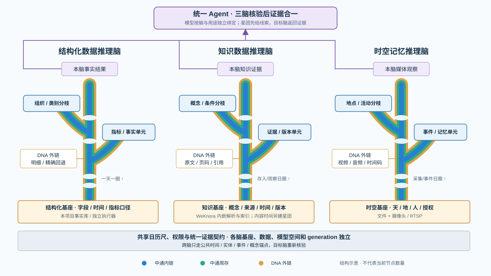
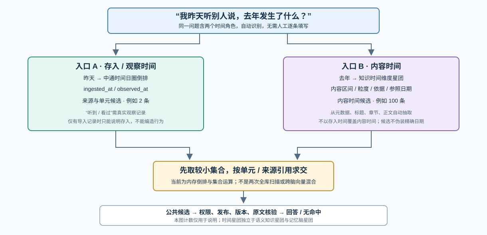
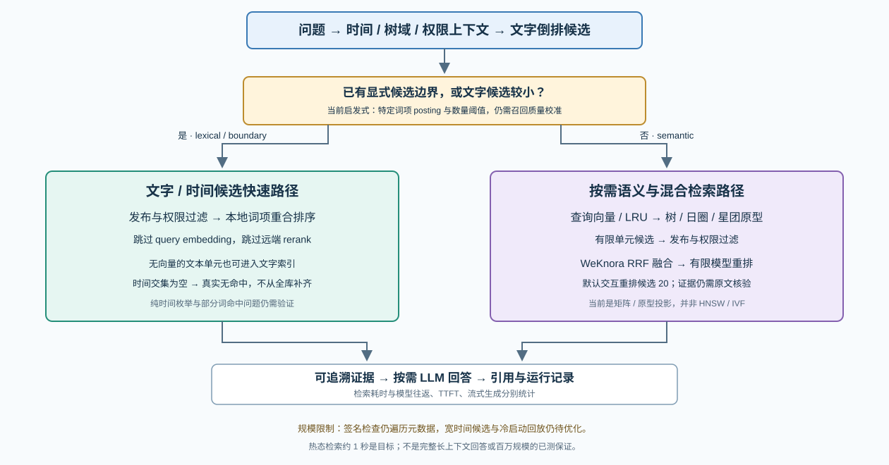

# 链式多维时空知识库引擎：技术模式与实现现状

版本：V3.4 · 核对日期：2026-10-19。

本文与[主规划书](../链式多维时空知识库引擎-产品与技术规划书.md)共同维护。记录已确认的产品模式、当前代码路径和下一步工程工作；“代码已实现”不等于当前进程已加载，更不等于完成生产验收。本轮完成知识脑运行韧性实现与定向回归，没有重新导入医书、切换 embedding/rerank 空间，也没有改动结构化或时空脑的数据与查询逻辑。

## 1. 技术演进总览

| 变化 | 当前实现或已确认模式 | 需要保留的限制 |
|---|---|---|
| 独立工程 | 结构化引擎、Node Agent、CNTS 源码迁入 `services/`，使用本安装的数据和配置 | 不依赖原项目进程；旧业务库、账号、密钥和 Catalog 未随代码复制 |
| 统一 Agent 的 3+1 | 星团快速线索 → 按需三脑核验 → 证据合一；专脑通过按钮进入 | 1 是快速通道，不是第四脑；某脑失败不能伪造其结果 |
| 模型按用途隔离 | 编排 chat；各脑 chat；知识 embedding/rerank；时空视觉/转写分别配置 | 不因统一入口就混用模型空间；无编排模型时并列保留脑结果 |
| 三脑双视图 | 树形架构原理图与来源关系拓扑；知识脑使用自己的画布 | 展示实际节点和版本；声明了分枝字段不等于已经长出分枝 |
| WeKnora 内嵌 | 锁定受管源码、内部 STDIO JSON 桥、父子分块、语义路径融合重排、Wiki/图谱候选与评测 | 只在知识脑内部；未引入上游 Vue、身份或 Agent 产品层 |
| 知识自动化 | 文档主领域自动分类、知识单元继承主树、自动星团/分枝与 generation | 分类规则仍有覆盖边界；页面可观察和纠偏，完整拆分/合并台待完善 |
| 双时间轴 | 内容时间与存入/观察时间分别抽取、索引，自动选择单入口或交集 | 没有观察记录时不能把导入说成“已读过”；古籍纪年尚未完整覆盖 |
| 自适应检索 | 文字/时间边界优先；需要语义时才生成 query 向量；版本化只读查询快照与有限缓存 | 当前词项索引不是 BM25，向量矩阵不是 ANN；质量与规模需实测 |
| 运行可观测性 | 步骤、检索耗时、模型往返、TTFT、流式生成、超时统计；暂停/撤回与轻状态轮询 | 新增细粒度 retrieval 指标当前在 API；并非全部已有页面展示 |
| 统一数据接入 | 一个菜单内结构化/知识/时空页签；一个导入任务入口 | 三脑存储和导入契约仍独立，界面收敛不改变数据归属 |
| 处理/发布分离 | `processing_status` 与 `publication_status` 两列，保留真实审核记录 | 批准发布不修复 OCR 缺页和摘要失败；“部分完成”需要看具体阶段 |
| 时空双入口 | 文件、本机摄像头与 RTSP 适配器 | 视频语义完整度、外部设备与并发仍需现场验收；本轮不改其算法 |

## 2. 统一入口与三脑独立运行

统一 Agent 共享产品入口与会话体验，不将三个专脑的实现合并。控制面冻结权限、时间与运行配置，先取得可追溯的星团线索，再按问题选择相关脑；无需调用的脑显示未路由。结构化脑负责精确事实，知识脑负责资料证据，时空脑负责媒体/观察。最终合一保留来源、指标口径、版本、无命中与失败信息。

会话置顶、重命名、归档/恢复、删除，回答复制、赞踩和分枝会话，以及布局、Skills、智慧树入口、结构化图表和运行轨迹均属于产品交互。统一视图须保留专脑返回的图表结构，不能只拼接 Markdown 后声称“图已生成”。运行步骤是工具执行记录，不展示或伪造模型内部思维链。

模型通过脑与用途绑定。统一编排模型只组织已核验结果；知识 embedding 的空间身份、维度、归一化方式和版本与资料向量保持一致。另两脑的原始向量不能直接参与知识星团距离计算。

## 3. 智慧树：一个结构，两种视图

图中每棵树从本脑基座向上生长，管状主干沿日圈堆叠，侧枝指向本脑的真实知识/事实/记忆单元。蓝色为中通内链，绿色为周存，金色为 DNA 外链；外侧指针连到原文、明细或媒体。图为结构示意，不包含伪造的生产节点数。

| 视图 | 需要展示 | 数据依据 |
|---|---|---|
| 架构原理/森林图 | 基座、向上主干、一天一圈、内链/周存/外链、实际分枝、脑内汇总与输出 | 本脑拓扑快照、generation、分枝状态、真实与抽样数量 |
| 来源关系图 | 来源/文件 → 处理模块 → 门禁 → 单元/路径 → 星团/索引 → 证据与版本 | 来源 ID、父子块、单元 ID、证据定位、引用边与发布状态 |

三脑遵循相同展示语义，但载荷和组件独立。结构化脑展示数据源、数据集、字段、查询路径、实际分枝与事实结果；知识脑展示来源、内嵌 WeKnora、概念/时间、周存单元、向量留痕、星团与原文；时空脑展示设备/文件、采样与提取、时空记忆单元、星团与媒体定位。拓扑不能把“字段建议数量”当成实际生长数量。

“一天一圈、一花一世界”是分区、引用和生长的组织方式，不天然保证任意规模的检索都为常数时间。索引、缓存、候选裁剪和模型执行仍需独立工程优化。

## 4. WeKnora 在知识智慧树内部的位置

上游锁定提交：`97796c637aa53713edc846bd0a39470d687f0fdf`。本工程维护原样文件、哈希、派生模块与通知，不把上游内部数据库当作本项目事实源。管理平台使用 `platform_server/knowledge_runtime.py` 的 `EmbeddedRuntime`；`BuiltinKnowledgeRuntime` 仅用于开发/契约测试，不作为生产失败回退。

当前链路：宿主接收原件并提取 PDF/DOCX/文本或执行本地 OCR → 内部桥调用 WeKnora 父子分块等模块 → 配置的真实 embedding → 知识单元、证据和本脑索引投影 → 自动星团/分枝与已发布版本。语义检索路径继续使用 WeKnora 融合和模型重排。

原文定位保存在 DNA 外链；索引空间、版本、检索/重排留痕与证据状态由中通周存承载。WeKnora 索引在物理上可重建或独立存放，授权、发布、最终拓扑与回答的所有权仍属于知识脑。Wiki/图谱当前是摘要和概念候选，不是完整的 Wiki 编辑器或图数据库产品。

## 5. 双时间轴与知识时间维度星团

| 时间角色 | 字段/来源 | 回答的问题 | 限制 |
|---|---|---|---|
| 存入时间 | `ingested_at`、`ingest_day_key` | 最近导入了什么 | 文件导入不等于发生过阅读或听闻 |
| 观察时间 | `observed_at`，真实用户行为或记忆关联，可空 | 昨天实际看过/听到什么 | 当前没有完整自动阅读行为采集，不填造观察时间 |
| 内容时间 | `ContentTimeAnchor` 的 `start/end/granularity/time_type/raw_expression/source_locator/extraction_method/confidence/status/reference_date` | 去年发生什么、某年案例、何时生效 | 模糊或相对时间保留依据，不能把导入日期当内容日期 |

系统自动结合元数据、标题、章节和正文中的绝对日期、区间与部分相对表达式抽取内容时间，不要求人工逐条输入。不确定结果保留候选，不阻塞原件入库；古籍年号、干支、OCR 错字和复杂叙事仍需扩展识别与验证，不能声称所有医书时间均已正确转换。

语义知识星团按同一向量空间中的相似特征形成，身份键不含日期；独立成员引用保存日期。知识时间维度星团按内容时间桶组织单元、文档和证据引用，是另一类索引，不改变语义星团身份，也不替代记忆脑的记忆星团。

“去年发生了什么”走内容时间；“最近导入了什么”走存入时间；“昨天听说去年发生的事”需真实观察/来源记录与内容时间共同匹配。当前先分别读取内存倒排，再按集合大小排序求交；代码中的 `parallel-intersection` 是策略标签，不代表启用了线程、远程并行或基于统计的完整代价优化器。观察与存入候选当前可并集形成进入系统的一侧，严格“看过/听过”的产品语义仍需真实行为证据约束。

内容、存入和观察索引的有序日键通过二分找到日期范围，再合并对应桶。当前内容时间长区间会展开为逐日 posting，查询投影恢复仍可能整体重建；区间压缩、局部增量维护和宽时间结果分页属于后续规模化工作。

## 6. 知识脑文字优先的自适应检索

| 模式 | 触发与计算 | 模型调用 | 输出限制 |
|---|---|---|---|
| `lexical` | 词项倒排得到较小候选，满足当前启发式；本地词项重合排序 | 跳过查询 embedding 与远端 rerank | 仍校验发布、权限、原文定位；词项命中不等于已能回答问题 |
| `boundary` | 已有时间交集或跨脑候选单元边界，限定范围内筛选和本地排序 | 跳过查询 embedding 与远端 rerank | 现有代码仍要求词项匹配；宽时间枚举、无主题词查询需继续验证 |
| `empty-boundary` | 显式候选交集为空 | 不生成查询向量，不用全库补齐 | 返回真实无命中；不伪造交集或放宽时间范围 |
| `semantic` | 文字路径为空或过宽；生成/复用查询向量，按树/日圈/星团缩小单元候选 | embedding → WeKnora RRF 融合 → 有限模型 rerank | 当前交互重排候选默认 20，最终回答整理最多 8 条引用；不是取最近一个向量直接裁决 |

快速路径的当前条件包括长度至少 2 的词项 posting 命中和候选数量阈值，不是完整语义充分性判断。上线前需以同义改写、否定、多个条件和资料无答案问题验证召回质量，避免“局部词命中就跳过语义”漏掉更好的证据。

文字索引覆盖有可搜索正文的知识单元，即使单元没有向量；向量矩阵只保存有真实向量的单元，二者分开维护。空的父容器不作为独立可搜索内容。但普通导入管道当前仍同步请求 embedding；索引支持无向量文本不代表已经交付“无模型导入模式”或后台异步向量队列。

现有词项索引使用中英文词项/汉字片段倒排和重合度排序，不是 BM25/FTS5。语义层是树/日圈/星团原型、NumPy 向量矩阵与有限候选，不是 HNSW/IVF；冷启动缺少星团时仍有单元向量矩阵兜底。资料未变时查询使用显式就绪的索引与激活快照，不再以全体单元签名确认索引；但宽时间候选尚未统一分页，且不是百万级规模验收。

## 7. 缓存、持久化与重启恢复

| 层 | 当前保存内容 | 失效/恢复 |
|---|---|---|
| 平台 SQLite | 账号/角色、模型配置、资产任务、审核、会话运行记录、拓扑快照、模型结果缓存 | 本安装独立；备份需包含密钥和内容目录，不只复制运行中的主文件 |
| 原件与提取缓存 | 内容寻址原件、提取文本、OCR 页级结果及定位 | 同文件失败重试复用成功步骤；不要求再次上传全部医书 |
| `knowledge_cache` | 按 owner、模型 namespace、operation、输入 digest 缓存解析/分块/向量/图谱/摘要结果 | 模型身份与空间变化不能混写；维度检查用于防止不一致 |
| 查询向量 LRU | 运行时版本 + 原始问题，容量 256 | 复用同空间重复问题向量；不是答案缓存，仍需重新校验权限/发布/版本 |
| 知识运行快照 | 外部版本化 `query-state.json`、路由元数据 `query-index.json`、只读词项工件 `lexical.sqlite3` 和安全 NPY 向量矩阵供 Agent 常驻；完整 `state.json` 只在智慧树画布、复核与纠偏按需读取。稳定查询态不保留单元/留痕重复字符串向量或完整 posting set；SQLite 只持有激活版本、路径、计数和审计 | 启动优先校验并映射轻量查询快照；schema 3 只生成词项工件即可升级到 schema 4，不重放原件、分块或 embedding；候选在后台完整构建后原子切换，缺少任何快照时才保留一次兼容恢复 |
| 结构化事实存储 | 本项目结构化服务自己的事实库、声明与候选 CNTS Catalog | 仍由结构化脑负责；知识脑优化不迁移或替换它 |

因此当前既不是“查询时每次直接读取整本 TXT”，也不是“已接入专用向量数据库”。TXT 可减少某些文件解析成本，不能替代全文索引、embedding、证据治理或问答模型。FTS5、外部向量库和模型迁移属于可选后续，须以实际瓶颈与规模测试决策。

## 8. 自动分类、自生长与双状态

知识领域按文档标题、章节与全文依据确定，单元继承主树。`document-subject-v2` 是可解释本地规则，低支持度或多领域接近时保留待归类，不能因零散“温度/成本”词把医书误归设备/财务树。分类纠偏复用原件与缓存，保留 ID、证据、审核历史和旧快照。

| 状态 | 含义 | 用户操作 |
|---|---|---|
| 处理成功 | 解析、索引等已完成 | 看证据和结果，不重复导入 |
| 部分完成 | 部分步骤成功，但有缺页、摘要/图谱或其他阶段失败 | 查看任务详情，针对失败阶段重试；不是自动等同待审核 |
| 处理失败 | 本次处理未完成 | 保留原件并按明确错误修复/重试，不伪造成功 |
| 已发布 | 当前资料可按权限进入正式知识结果 | 可管理发布或撤回；不掩盖处理问题 |
| 待复核/已拒绝 | 尚不能作为正式已发布证据 | 根据风险与真实记录复核；不为修正显示而补造批准 |

普通低风险资料自动处理、生长和发布；人工仅承担风险复核与事后纠偏。完整星团拆分、合并、冻结管理和删除/权限撤销的全链路传播仍需开发验收。

## 9. 医书问答与已有数据复用

已有成功解析、分块和发布的医书不用重新上传。重启后可复用缓存恢复内存索引；失败文件、未完成 OCR 或没有知识单元的文件单独重试。分类或发布异常先查对应状态，不用全量重新导入掩盖问题。

问及方剂时，产品可依据已导入资料整理历史方剂名称、文献记载的适用背景、书名、章节/页码与引文，区分古代概念和现代诊断。必须注明“仅供学习和文献参考，不能作为实际治疗依据”，不把资料匹配生成个体诊断、处方或自行用药指导；没有出处时明确证据不足。本节不提供任何实际医疗建议。

未来更换 embedding 模型时保留原文与知识单元，在新空间重建向量并验收后切换，不混合不同维度或版本。候选快照在后台构建，带文件 SHA-256 清单校验并原子激活；当前已有知识索引时仍禁止把已绑定 embedding 模型直接改写到旧空间。

## 10. 性能分解与验收目标

总体耗时应按可观察边界分解：请求规划与索引检查 + 时间定位/候选召回 + query embedding（如需）+ 融合/重排（如需）+ 证据整理 + 模型往返 + 保存/呈现。热态精确或时间索引定位约 1 秒是用户目标，需要明确数据规模、硬件、冷热态与 P50/P95；不把它套到完整长上下文回答。

| 指标 | 当前含义/位置 | 解读 |
|---|---|---|
| `last_retrieval` / 搜索 `retrieval` | `mode`、candidate_count、embedding_used/cache_hit/ms、index/lexical/semantic/local_rank 或 fusion_and_rerank、total_ms | 当前为工作区最近一次诊断，不能当作全部并发请求的持久指标；部分索引前置工作在该计时之外 |
| `temporal_plan` | 两侧候选、交集数量、index_lookup_ms、intersection_ms、strategy | 衡量时间索引与求交；策略标签不证明并发 |
| `retrieval_duration_ms` | Agent 记录的检索前置 | 与模型服务往返分开看 |
| `provider_roundtrip_ms` | 发出模型请求到响应完成 | 含网络、服务等待和生成，无法单独推断服务端排队 |
| `ttft_ms` | 发出请求到首个可观察流式 token | 含网络、队列、预填充；不是纯网络时间 |
| `generation_duration_ms` | 首个到最后一个可观察内容 token 的流式接收间隔 | 仍含传输影响，不是服务端纯 GPU 计算时间；非流式为空，不反推 |
| 最近/P95/超时统计 | 模型配置页基于保存的运行样本汇总 | 新模型/不同上下文长度分别比较；少量样本不证明稳定 SLA |

对话请求默认超时为 90 秒，显式配置以保存值为准；这不是性能优化，也不证明模型一定合适。客户端无法仅凭一次超时把原因判定为网络或生成，应结合 TTFT、流式阶段、输入长度、提供方状态和重复样本判断。

## 11. 尚需继续的工程优化

1. 工件已用激活版本、轻量查询投影和显式索引就绪标记替代正常查询的全单元签名遍历；完整治理/树图状态不再随 Agent 常驻。后续补增量工件写入和删除/权限变化的局部失效，避免全量候选构建。
2. 时间区间采用压缩桶/区间索引；宽时间查询分页，严格区分真实观察与存入语义，扩展古籍纪年。
3. 建立检索质量门禁后校准文字快速路径；必要时退入语义召回，不只凭候选少就认为证据充分。
4. 批量异步 embedding、独立模型资源与导入-查询隔离；候选构建已移出前台查询锁，但单元同步向量化仍可能拖慢导入完成时间。
5. 用真实规模与标注问题集比较现有投影、FTS/BM25、ANN；保证权限、引用、版本和召回正确性后再迁移。
6. 新增检索细项按 run 持久化并呈现，补冷恢复、宽时间、并发、撤销与大文档的验收数据。

EmbeddingGemma 2 等候选模型没有在当前工程采用；本页不复述未经本项目验证的体积、参数或延迟数字。评估模型需另行核对官方版本、中文效果、CPU/GPU 占用、索引空间兼容与实际查询表现。

## 12. 源码与验证入口

| 主题 | 代码或文档 |
|---|---|
| 检索路线与缓存 | [brain.py](../brains/knowledge/src/brain.py)、[query_index.py](../brains/knowledge/src/query_index.py) |
| 时间抽取、日桶与求交 | [temporal.py](../brains/knowledge/src/temporal.py)、[workbench.py](../brains/knowledge/src/workbench.py) |
| WeKnora、持久缓存 | [knowledge_runtime.py](../platform_server/knowledge_runtime.py)、[第三方范围](../third_party/weknora/README.md) |
| 本地模型、快照与恢复 | [local_models.py](../platform_server/local_models.py)、[knowledge_snapshot.py](../platform_server/knowledge_snapshot.py)、[ingestion.py](../platform_server/ingestion.py) |
| Agent 与模型计时 | [agent_runs.py](../platform_server/agent_runs.py)、[unified_agent.py](../platform_server/unified_agent.py)、[model_metrics.py](../platform_server/model_metrics.py) |
| 验收与部署 | [首次使用手册](首次使用与生产验收测试手册.md)、[部署说明](production-platform.md) |
| 本次证据 | [归档与同步记录](archive/2026-10-19/归档与同步记录.md)、[修订前文档哈希](archive/2026-10-19/before-update-manifest.json) |

既有设计文件保留其历史目标；当设计中的性能、并行或增量要求尚未落地时，以本页明确标注的现状和待办为准。本轮验证覆盖快照恢复、知识/统一 Agent 的运行轨迹，以及暂停/撤回回归和前端生产构建；仍未以真实模型和全量医书完成冷热态、并发或生产性能验收。
